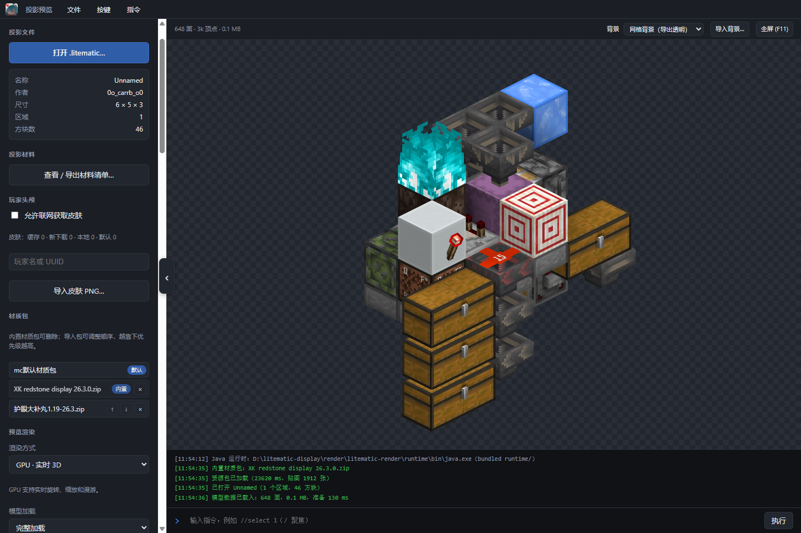
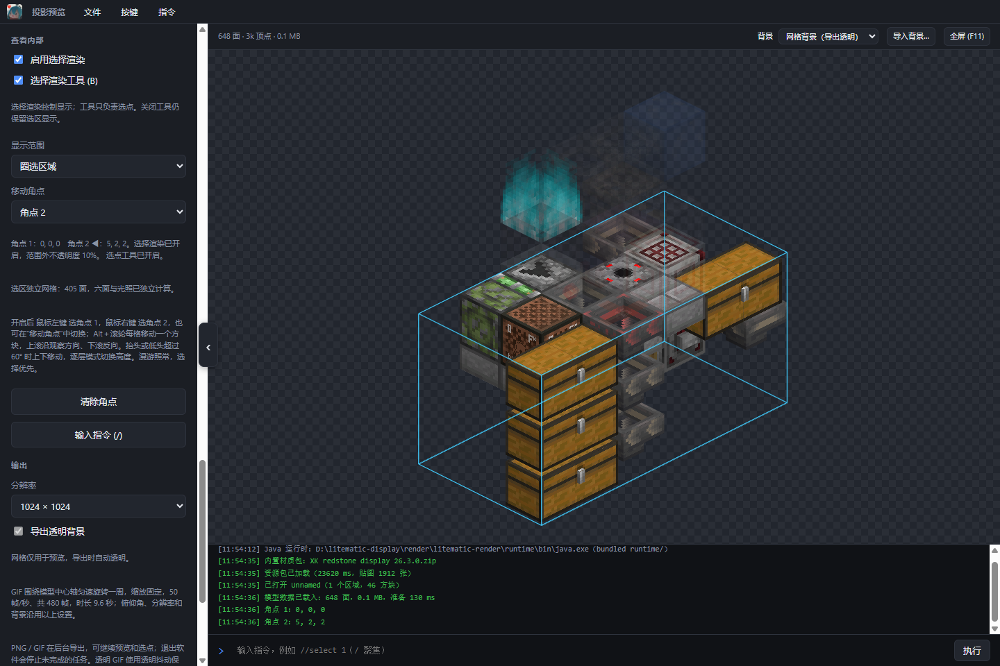

# 投影预览 · Litematic Viewer

不用启动 Minecraft，就能打开 `.litematic` 投影，旋转预览、进入建筑内部查看、统计材料，并导出 PNG 图片或旋转 GIF。

**当前版本：1.1.1.2 · Windows 10 / 11，64 位**

[下载 Windows 便携版](https://github.com/wocenimenma0220/Standalone-Litematic-Renderer/releases/latest) · [更新记录](评估与测评/CHANGELOG.md) · [开发与命令行说明](docs/DEVELOPMENT.md)

## 下载后怎么用

1. 在 Release 页的 **Assets** 中下载 `Litematic-Viewer-<版本>-win-x64.zip`。
2. **完整解压**到一个文件夹，双击里面的 **投影预览.exe**。便携版自带 Java 和 Electron，无需另行安装。
3. 点击 **打开 .litematic…**，或把一个投影文件拖进窗口，等模型显示后就可以拖动旋转、滚轮缩放。拖入文件时，左上角会显示圆角提示。

也可以把 `.litematic` 文件拖到 EXE 上打开。请保留 EXE 旁的 `assets`、`bin`、`runtime`、`webapp` 文件夹；GitHub 自动生成的 `Source code` 压缩包用于开发，不是可直接运行的便携版。

顶部背景选择旁的 **停止渲染** 可以强制停止当前预览，包括文件读取、光照计算和模型准备。任务进行中拖入新投影会自动停止旧任务，连续拖入时以最后一个文件为准。停止后可点击 **重新渲染** 继续；后台 PNG / GIF 导出单独运行，不受这个按钮影响。



*实际界面：使用「1.8w-潜影贝收集」投影展示完整预览。*

## 主要功能

| 功能 | 可以做什么 |
| --- | --- |
| 实时预览 | 旋转、缩放、切换预设视角，使用 GPU 或 CPU 预览 |
| 二维搭建 | 侧视或俯视摆放方块、选择完整状态、模拟水流，支持拖动、撤销和画布保存 |
| 漫游查看 | 进入投影内部，查看方块、实体状态和容器保存的内容 |
| 查看内部 | 选择一个区域或单层，范围内正常显示，其余部分淡化到 10% 不透明度 |
| 图片与动画 | 在后台导出 PNG 或一周旋转 GIF，可继续操作预览 |
| 材料清单 | 分别统计建材和容器内容，换算组数、盒数，导出 XLSX / CSV |
| 外观设置 | 导入材质包、玩家皮肤和背景图片，调整光照 |
| 操作配置 | 自定义按键，在底部直接输入指令 |

## 常用操作

以下是默认按键。顶部 **按键** 面板中，点击要修改的绑定，再按一次新键即可保存；重启后仍然生效。顶部 **指令** 面板可查看全部支持的指令。

| 操作 | 默认按键 |
| --- | --- |
| 旋转 / 缩放投影 | 在预览区按住左键或右键拖动 / 滚轮 |
| 进入 / 退出漫游 | `V` |
| 漫游前后左右移动 | `W` / `S` / `A` / `D` |
| 漫游上升 / 下降 | `空格` / `Shift` 或 `C` |
| 漫游加速 / 转向 | 按住 `Ctrl` / 移动鼠标 |
| 查看准星所指的方块或实体 | 漫游中按左键，需先关闭选择工具 |
| 开启 / 关闭选择工具 | `B` |
| 设置角点 1 / 角点 2 | 选择工具开启后按左键 / 右键 |
| 微调当前角点或层高 | 选择工具开启后按住 `Alt` 并滚动滚轮 |
| 聚焦底部指令输入 / 执行 | `/` / `Enter` |
| 释放漫游鼠标、返回预览或退出全屏 | `Esc`，按当前状态处理 |
| 切换全屏 | `F11` |

漫游会锁定鼠标。按 `Esc` 或切换窗口后，点击预览区可继续转向；输入指令时会暂停漫游移动。

## 怎么看建筑内部

左侧 **查看内部** 有两个独立开关：

| 开关 | 作用 |
| --- | --- |
| **选择渲染工具 (B)** | 接管左右键和 Alt＋滚轮，用来设置、调整角点 |
| **启用选择渲染** | 按选好的范围显示模型，范围外保持 10% 不透明度 |

### 圈选区域

1. 等待 GPU 预览就绪，在 **显示范围** 中选择 **圈选区域**。
2. 按 `B` 开启选择工具，左键选角点 1，右键选角点 2。两个角点所在的方块都包含在范围内。
3. 需要调整时，在 **移动角点** 中选择角点 1 或 2，再按 `Alt＋滚轮`，每次移动一个方块。上滚沿观察方向、下滚反向；抬头或低头超过 60° 时上下移动。
4. 勾选 **启用选择渲染**，查看选区内部。程序会为切口重新计算实际模型表面和光照。
5. 选好后可按 `B` 关闭工具，继续旋转或查看方块；选区显示会保留。取消 **启用选择渲染** 才会恢复完整显示。



*实际界面：选择「1.8w-潜影贝收集」的下半部分，淡化上方结构以查看内部。选区同样可用于 PNG / GIF 导出。*

### 逐层查看

把 **显示范围** 改为 **逐层查看**，用高度输入框或滑杆指定 Y 层。开启选择工具后，也可以用 `Alt＋滚轮` 逐层切换。

这两种查看方式都支持漫游。选择工具开启时，左右键选点优先于方块详情；关闭工具即可恢复详情查看。选择范围不会改动原始投影文件。

### 用指令精确设置角点

先开启选择工具，再点击底部日志下方的输入行，或按 `/` 聚焦，输入后按 `Enter`：

```text
//select 1
//select 2
```

这会选择当前准星所指的方块；漫游中未指向方块时，使用当前位置。也可以直接指定坐标：

```text
//select 1 -10 64 20
//select 2 30 80 50
```

坐标使用预览中的投影坐标，支持负数。执行成功后可继续输入，输入有误会保留原文并提示原因；`Esc` 返回预览。

## 导出 PNG / GIF

在左侧 **输出** 中选择分辨率和背景，再点击 **导出 PNG…** 或 **导出 360° 旋转 GIF…**，指定保存位置。文件菜单也提供这两个入口。

| 格式 | 输出效果 |
| --- | --- |
| PNG | 512 / 1024 / 2048 / 4096 像素方图，保留完整透明度 |
| GIF | 50 FPS、480 帧、9.6 秒，围绕模型中心旋转一周，镜头中心与缩放固定 |

导出使用侧栏设置的角度、光照、背景和选择范围，保留完整模型细节，不受预览 LOD 或漫游视距限制。

PNG / GIF 会进入**后台导出队列**，预览下方显示准备、渲染和编码进度。期间可以继续旋转、漫游、调整选区，甚至打开另一份投影；任务使用提交时的投影和输出设置。可取消任务，完成后点击 **打开位置** 找到文件。**退出软件会停止未完成的导出**。

- 默认网格只用于预览，导出时为透明背景。
- 想要背景颜色或图片，可在预览区右上角选择，并取消 **导出透明背景**。背景图支持不超过 10 MB 的 PNG / JPG。
- GIF 只支持透明或不透明，透明背景下用固定抖动保留淡化部分，会有细点效果；选择颜色或图片背景可得到平滑的淡化效果。

## 材料清单和容器内容

点击左侧 **查看 / 导出材料清单…**，或文件菜单中的对应选项，即可分别查看建材与容器内容物。支持按名称或 ID 搜索，显示数量、组数、余量和所需盒数。

- 导出格式可选 XLSX / CSV，范围可选两类合并、分别导出、仅建材、仅容器内容物。
- 盒数按 27 格潜影盒换算，达到半盒才显示所需盒数；不同物品使用各自的堆叠上限。
- **水桶换算为冰**会把建材中的用水量按 1:1 换算为普通冰，并合并已有冰；导出采用当前换算结果，容器内保存的物品保持原样。
- 未保存库存、未生成的战利品和未知堆叠上限会提示，避免把未知内容算成空容器。

漫游中关闭选择工具，左键点击方块或实体，还能查看其状态和保存的容器内容。相同物品且数据相同的多组物品会合并显示；点击物品可展开详细数据。详情面板只读，关闭面板或点击预览区可继续漫游。

## 材质、皮肤和光照

- **材质包**：随包提供原版资源与外观包，可导入 ZIP 或文件夹。列表中越靠下优先级越高；移除内置外观包只取消加载，可从 `assets/builtin` 重新导入恢复。
- **玩家皮肤**：可按玩家名 / UUID 联网获取，也可导入本地皮肤 PNG。关闭联网后仍可使用缓存和本地皮肤；缺失或获取失败时使用默认皮肤。
- **光照**：新设置默认开启 **开启光照渲染** 和 **平滑光照**。关闭平滑光照使用较明亮的效果；关闭光照渲染直接显示材质颜色。预览与导出共用这两个开关。

## 大投影怎么设置

一般保持默认即可。**模型加载**会自动选择完整或分块加载；大投影先显示简化总览，再逐步补上当前视角的完整细节。

| 设置 | 什么时候需要调整 |
| --- | --- |
| 模型加载 | 可手动选择完整模型或分块加载 |
| 按距离调整细节（LOD） | 分块模式下，降低远处细节以减少显存占用 |
| 细节加载方式 | 默认边加载边渲染；也可提前准备当前视距或整个投影的细节，并暂停 / 继续 |
| 预览几何缓存上限 | 初始按机器内存选择 128–512 MB，可设 32–16384 MB；预算不足时可适当提高 |
| 漫游视距 | 默认 6 区块，可设 1–128；每区块宽 16 格，只限制漫游中的水平范围 |
| 磁盘场景缓存 | 默认限额 4096 MB，设为 0 可关闭持久保留 |

**关闭应用时清理渲染缓存**默认开启，也会清理基础贴图缓存。希望下次启动和打开投影时复用缓存，可取消勾选；首次加载或资源变化后会重新准备。手动清理未使用的场景缓存不会删除配置、资源包、皮肤或导出文件。几何预算不等于软件的总内存上限，大型投影仍需要额外内存保存方块、光照和贴图。

## 常见情况

| 遇到的情况 | 处理方式 |
| --- | --- |
| 漫游时鼠标不再转向 | 点击预览区重新锁定鼠标；`Esc` 或切换窗口会主动暂停控制 |
| 左键一直选角点，打不开方块详情 | 按 `B` 关闭选择工具，再点击目标 |
| 选好角点却没有淡化效果 | 检查 **启用选择渲染**是否勾选，两个角点是否都已设置 |
| 只有灰色色块或正在补充细节 | 大投影尚在准备，先等待状态提示完成；日志中若有错误可重新渲染 |
| 无法漫游或使用选择工具 | 确认使用 GPU 预览；CPU 预览只提供旋转和缩放 |
| 重启后大投影仍重新准备 | 检查是否开启了退出清理缓存，或投影、材质、光照设置发生变化 |
| 双击 EXE 提示缺少文件 | 重新完整解压便携 ZIP，保留 EXE 旁的文件夹 |

## 支持范围与限制

- 支持 `.litematic` 版本 1–7、多区域及负尺寸区域。软件读取投影快照，不运行红石逻辑、生物 AI 或物理模拟。
- 支持普通方块、流体，以及箱子、潜影盒、告示牌文字、玩家与生物头颅、旗帜、讲台、信标、潮涌核心和铜傀儡雕像等特殊模型。
- 实体支持七类矿车、船与运输船（含竹筏）、雪傀儡、铁傀儡、猪灵、物品展示框和荧光物品展示框；其他实体尚未完整支持。
- 告示牌支持内置字体覆盖的中英文和常见字符；复杂文字样式、翻译组件及部分字形尚未完整支持。
- 模型、光照和实体外观属于离线近似；复杂物品组件、自定义运行时物品模型、附魔闪光和部分动态效果仍有限制。投影通常不保存世界地图像素，地图使用物品外观。
- 超大型建筑的完整细节准备仍受机器内存、显存和模型规模影响。

## 文档、开发与资源说明

- [更新记录](评估与测评/CHANGELOG.md)：逐版本功能、修复与验证记录。
- [开发与命令行说明](docs/DEVELOPMENT.md)：源码准备、构建、命令行导出和数据目录。
- [大投影架构说明](评估与测评/LOD_STREAMING.md)、[综合评估](评估与测评/投影渲染与区块缓存综合评估.md)：缓存、加载和渲染实现。
- [研究记录](评估与测评/RESEARCH_NOTES.md)、[后续待办](评估与测评/TODO.md)。

部分特殊方块模型参考 Enhanced Block Entities，来源说明与许可证见 [EBE-NOTICE.md](assets/builtin/static-block-entities/EBE-NOTICE.md) 和 [EBE-LICENSE.txt](assets/builtin/static-block-entities/EBE-LICENSE.txt)。随附 Minecraft 资源、字体与材质包按各自来源说明使用。

作者：kinda sus。
